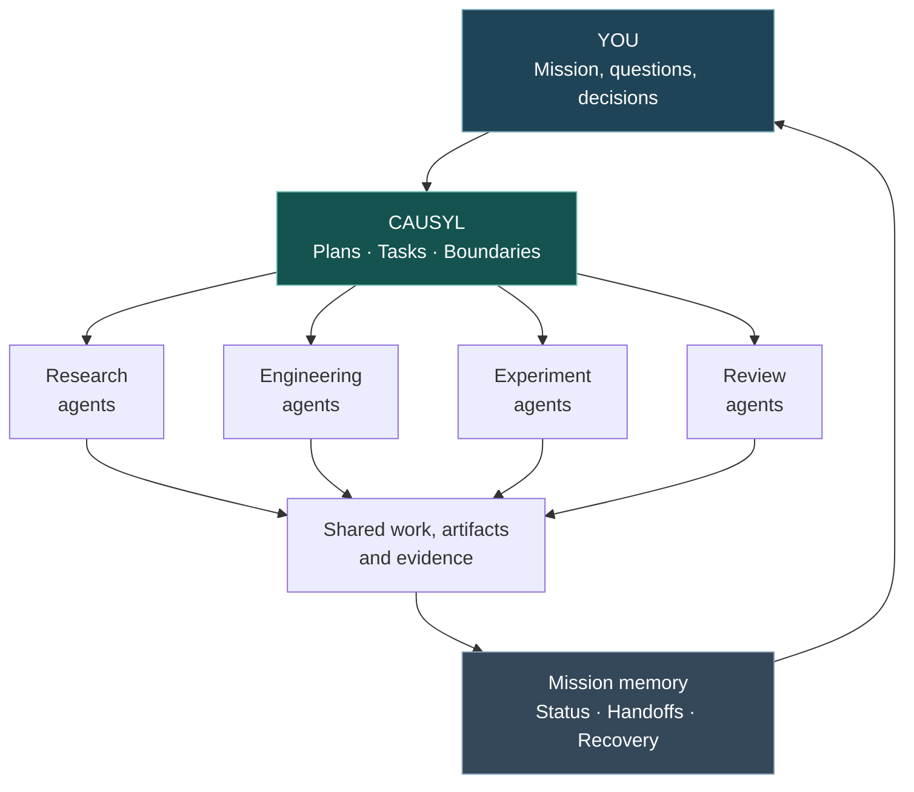

<div align="center">

# CAUSYL

### Your lab. Your agents. Your mission.

**An agent-based laboratory for research, engineering, and ambitious projects, with you at the controls.**

*Imagine a digital workshop where specialized AI agents can investigate, design, build, experiment, and review, working toward a mission that doesn't disappear when a conversation ends.*

[**Explore the lab ↓**](#the-vision-your-own-agent-powered-laboratory) · [**See the interface ↓**](#inside-the-operator-plane) · [**Try the verified preview ↓**](#try-the-verified-offline-slice) · [**What works today ↓**](#what-is-ready-today)

<br>


</div>

---

## The vision: your own agent-powered laboratory

Picture an engineering laboratory with a mission on the table.

You set the goal. **A research agent** investigates possibilities. **An engineering agent** works through designs or code. **An experimental agent** proposes tests. **A reviewer** challenges the results. Their work comes back to a shared place where you can inspect it, redirect it, or decide what happens next.

That's the laboratory Causyl aims to make possible: **a coordinated team of specialist digital assistants, directed by a human, with persistent missions and real evidence rather than isolated answers.**

The ambition spans scientific research, software, engineering and fabrication, materials and structures, and long-running projects. Think of the digital-assistant-powered workshop of science fiction, built around a practical constraint: **the laboratory must never pretend something happened merely because an agent says it did.**

> **You lead the laboratory. Agents help do the work. Causyl keeps everyone oriented.**

### One mission. Many possible specialists.

<table>
<tr><td width="50%" valign="top">

**🔬 Research & discovery**

Investigate questions, examine hypotheses, assemble references and propose experiments for human review.

</td><td width="50%" valign="top">

**🛠️ Engineering & creation**

Work through designs, code, technical problems and bounded implementation tasks, with outputs that can be inspected.

</td></tr><tr><td valign="top">

**🧪 Experiment & verification**

Run controlled checks where appropriate, compare outcomes and separate observed results from optimistic interpretations.

</td><td valign="top">

**🧭 Mission control**

See the work in progress, assign authority, review agent results and decide when to stop, resume or change direction.

</td></tr>
</table>

*These are **envisioned laboratory roles and workflows**, not a claim that all agent types are implemented or independently validated in the current public release.*

## From your idea to a coordinated laboratory



*Conceptual vision, not a currently demonstrated end-to-end multi-agent execution graph.*

**Why a laboratory needs a control plane:** complex work takes days, spans disciplines and gets interrupted. Causyl is designed to hold the mission together: durable tasks and handoffs, bounded delegation, inspectable artifacts, verification and honest recovery. Progress belongs to the mission, not to whichever agent is currently talking.

The project’s [mission contract](governance/plane_mission_contract_v1.json) defines the intended system as a persistent, operator-guided laboratory assistant that tracks work, delegates long tasks, recovers after interruption and reports with evidence. The public 0.1.0a3 source preview demonstrates a narrower subset; [see exactly what is verified](#what-is-ready-today).

## Inside the operator plane

These are **real interface renders** from the released source, displayed with fictional API data. They are not recordings of real delegated work.

<table>
<tr>
<td align="center" width="50%"><a href="docs/screenshots/change-ledger.png"></a></td>
<td align="center" width="50%"><a href="docs/screenshots/agent-surface.png"></a></td>
</tr>
<tr>
<td align="center"><strong>01 · Track the work</strong><br><sub>Ledger, ownership, states and inspectable history.</sub></td>
<td align="center"><strong>02 · Explore delegation</strong><br><sub>Agent-facing controls, with no real agent called during capture.</sub></td>
</tr>
</table>

<div align="center">
<a href="docs/screenshots/operator-mobile.png"></a>
<br><strong>03 · Stay oriented</strong><br><sub>Operator overview on a smaller screen.</sub>
</div>

<sub>The captures use intercepted synthetic responses, with real network activity, writes and providers blocked. [Screenshot provenance](docs/screenshots/CAPTURE_PROVENANCE.json).</sub>

## What is ready today?

**Causyl 0.1.0a3 is an experimental Linux developer source preview.** Its strongest release claim is a small but real **offline ledger and artifact-integrity workflow**. Some additional action-routing and local HTTP security boundaries have targeted test coverage, but they do not constitute a fully verified autonomous product.

| Area | Public-preview evidence |
|:--|:--|
| Durable ledger and artifact checking | **Verified offline demonstration**, including reopening state and detecting altered bytes |
| Source governance and action policies | 37 reconstructed tracked contracts; rejection and routing tests; not recovered original policy bytes |
| Local operator HTTP boundary | Auth/origin and refusal-path regression tests; opt-in loopback-only service, not a production deployment |
| Scheduler, queues, orchestration, agent interfaces | Components and contracts present; **not validated together for live operations** |
| Provider-backed or autonomous execution | **Not verified in this release** |
| Android client and deployment | Source retained, **not built or validated here** |

The release preparation recorded **383 passing selected tests** on each of Python 3.11, 3.12 and 3.14. The full historic suite, real agents and hosted operations were outside the verified boundary.

## Try the verified offline slice

No provider account, model key, GPU or running operator service is required.

```bash
git clone https://github.com/jedufa/causyl.git
cd causyl
python3 -m tools.release.demo
```

The demo exercises actual Causyl code: it writes a fictional ledger item, opens it with a fresh reader, independently verifies an artifact digest, and confirms that a tampered artifact is rejected. No external calls or agents execute.

For the selected regression suite:

```bash
python3 -m venv .venv
. .venv/bin/activate
python -m pip install -r requirements-test.txt
python -m tools.release.verify
```

The offline demo runs from the source checkout. This preview does not promise an installable wheel or turnkey operator deployment.

## Explore the architecture

Causyl separates **the human-facing plane** from **the durable truth that the plane must display**. The codebase contains experimental work in these areas:

| Surface | Where to look |
|:--|:--|
| Work ledger and histories | `infra/webui/ledger/` |
| Artifacts and experiment records | `experiments/shared/experiment_records/` |
| Scheduling, recovery, resource governance | `infra/controlplane/` |
| Staged pipelines and verification | `infra/pipeline/` |
| Agent integrations | `infra/agents/` |
| Browser and operator HTTP surface | `infra/webui/` |
| Formal action boundaries | [Governance contracts](governance/contracts/README.md) |

The project's [mission contract](governance/plane_mission_contract_v1.json) is the clearest source for its long-term identity. The [limitations](docs/release/LIMITATIONS.md) are the clearest source for what this exact public preview does **not** establish.

## A lab with you at the controls

Causyl is an **operator-directed lab**, not a magically omniscient assistant or an unattended laboratory director. Its design uses durable records and explicit boundaries so the operator can understand what is active, blocked, done, or uncertain.

The current operator runtime is opt-in and single-user on loopback. Agent/provider paths require separate configuration and validation. Do not expose the service on the Internet or assume its source-preview tests certify operational security.

[Local runtime and safeguards →](docs/release/LOCAL_RUNTIME.md) · [Security →](SECURITY.md) · [Limitations →](docs/release/LIMITATIONS.md) · [Dependencies →](docs/release/DEPENDENCIES.md)

## Explore, question, and carry it forward

Causyl is released as experimental, source-only software for study and independent extension. Its vision is deliberately broader than the currently validated demo. Independent forks and focused contributions are welcome, without a promise of maintenance, review, security support or future releases.

[Contributing →](CONTRIBUTING.md) · [License →](LICENSE) · [Third-party notices →](THIRD_PARTY_NOTICES.md)

First-party source, tests and documentation are **MIT licensed**. Copyright © 2026 Jean-Francois Dufour. Third-party materials retain their own terms.

---

<div align="center">

### Bring the lab to your mission. Keep the human in command.

**CAUSYL · Your agent-powered laboratory, with durable truth underneath.**

</div>
