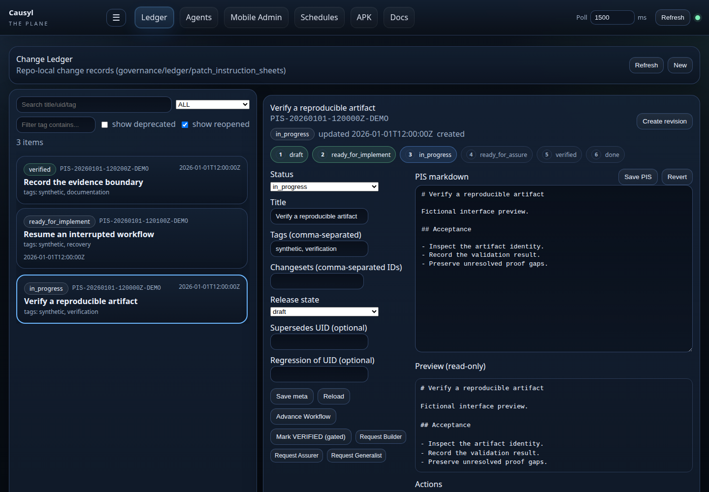
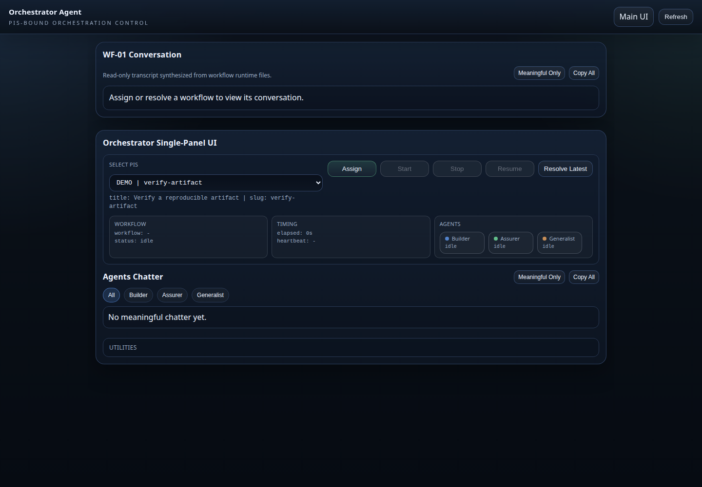
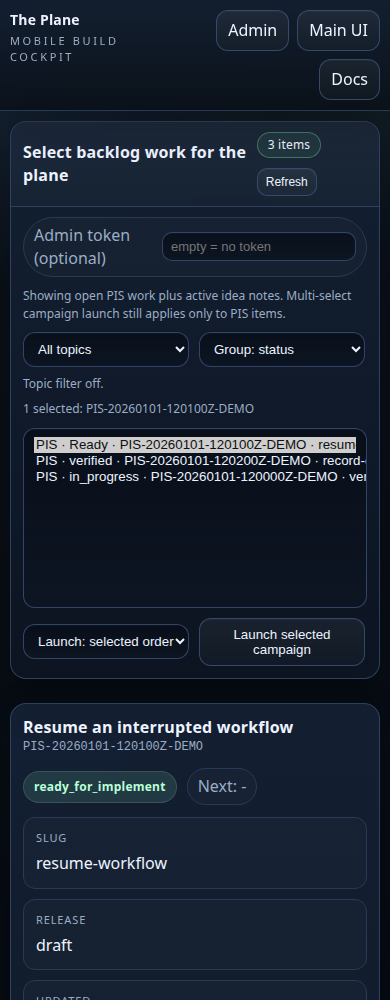
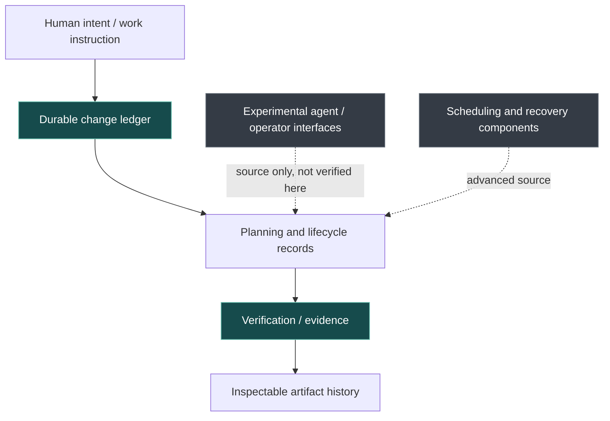

<div align="center">

# CAUSYL

### Autonomy deserves an audit trail.

**An operator plane for engineering work you can inspect, verify, and recover.**

*Make the plan visible. Keep the execution accountable. Preserve the evidence.*

[**Try the offline demo →**](#start-with-something-real) · [**Explore the architecture →**](#inside-the-plane) · [**Review safety boundaries →**](#before-you-run-any-agents)

<br>


</div>

---

## When an agent says "done," what actually happened?

Software agents can generate plans, launch commands, modify files, and produce convincing summaries. But a convincing summary is not the same thing as a verified result.

**Causyl is an experiment in putting a dependable record between intention and outcome.**

It brings work items, execution planning, recoverable history, artifacts, checks, and optional assistant interfaces into a single *operator plane*. The idea is simple: an action should leave enough structure that a person can understand **what was requested, what was attempted, what changed, and what the evidence supports**.

Causyl 0.1.0a3 is shared here as an **early Linux developer source preview**, not a production-ready autonomous operator. The verified starting point is deliberately small and offline.

## A look inside the plane

<table>
<tr>
<td align="center" width="50%"><a href="docs/screenshots/change-ledger.png"></a></td>
<td align="center" width="50%"><a href="docs/screenshots/agent-surface.png"></a></td>
</tr>
<tr>
<td align="center"><strong>01 · Keep the work visible</strong><br><sub>Ledger entries, status, and inspectable change records.</sub></td>
<td align="center"><strong>02 · Understand delegation</strong><br><sub>Agent-facing controls as a source-interface preview, not a proven execution service.</sub></td>
</tr>
</table>

<div align="center">
  <a href="docs/screenshots/operator-mobile.png"></a>
  <br><strong>03 · Review on a smaller screen</strong><br>
  <sub>Responsive operator interface, rendered against offline synthetic fixtures.</sub>
</div>

<sub>Rendered interface previews captured from the repository's actual HTML/CSS/JavaScript with fictional, intercepted API responses. Every network request is intercepted; writes and external destinations are blocked. No operator server or agent ran during capture. [Capture provenance](docs/screenshots/CAPTURE_PROVENANCE.json).</sub>

## What Causyl is trying to solve

<table>
<tr>
<td width="50%" valign="top">

### 📋 Work with memory

A durable ledger records work instructions and state changes. A plan can outlive the process that created it.

</td>
<td width="50%" valign="top">

### 🧾 Results with receipts

Artifacts can be hashed, inspected and associated with work. Altered bytes should not silently pass for prior evidence.

</td>
</tr>
<tr>
<td valign="top">

### 🔄 Recovery as a design constraint

The source includes job lifecycle, scheduling, recovery and resource-control components for studying interrupted work.

</td>
<td valign="top">

### 🤝 Agents without blind trust

Optional assistant adapters and operator surfaces exist to explore delegation. Their source is inspectable, **but live execution is not part of this verified preview**.

</td>
</tr>
</table>

> **The principle:** A record of intent is not proof of completion. Evidence should be distinguishable from narration.

## Start with something real

The included offline demonstration uses **Causyl's actual ledger and artifact code**, not a simulated replacement. It creates a fictional item, opens the ledger through a fresh reader, verifies a file digest independently and detects an intentionally changed artifact.

No API key, AI model, GPU, network service, or live agent is needed.

**From a Linux source checkout, with Python 3.11 or later:**

```bash
git clone https://github.com/jedufa/causyl.git
cd causyl
python3 -m tools.release.demo
```

The command reports `ledger_persisted`, `artifact_digest_verified`, `tamper_negative_control_detected`, and `network_or_agent_calls: 0` when the demonstration succeeds. Fictional temporary data is removed when the demo ends.

**Run the selected tests:**

```bash
python3 -m venv .venv
. .venv/bin/activate
python -m pip install -r requirements-test.txt
python -m tools.release.verify
```

The current preview reports **383 passing selected tests** in each of three isolated Python environments: **3.11, 3.12 and 3.14**. This tests a supported source-preview slice; it is not the complete historical test suite or a full application validation.

## Inside the plane



*Conceptual map of responsibilities, not a claim that all components form one validated end-to-end runtime.*

| Start here | What you'll find | Status in this preview |
|:--|:--|:--|
| `infra/webui/ledger/` | Durable work items and evidence records | **Demonstrated offline** |
| `experiments/shared/experiment_records/` | Artifact identities and digest checking | **Demonstrated offline** |
| `infra/controlplane/` | Scheduling, resource policy, recovery | Selected tests only |
| `infra/pipeline/` | Planning, review and verification stages | Source available; wider routes unverified |
| `infra/agents/` | Optional model and coding-agent adapters | **Not run** |
| `infra/webui/` | Browser and experimental HTTP operator service | Rendered UI previews; isolated HTTP authentication tests |
| `infra/mobile/android/` | Android client source | Not built or tested for release |

## Before you run any agents

The operator runtime remains opt-in, local and experimental. A shared authorization gate now protects operator routes before dispatch, checks Host and browser Origin, and provides expiring login sessions. Assistant API scopes remain separate. Real loopback tests verify rejected requests and bounded successful writes; this is not an Internet-facing or multi-user service.

The 37 action-plane policy definitions are now tracked source, reconstructed from written contracts and existing implementations. Missing or weakened safety boundaries fail closed. [Provenance](governance/contracts/README.md) distinguishes recovered behavior from explicit new policy choices. CLI and synthetic end-to-end scenarios are included in the selected suite.

See [local runtime instructions](docs/release/LOCAL_RUNTIME.md) before enabling it. Optional workers and provider adapters require their own configuration and validation.

This preview does **not** claim safe autonomous execution, hosted operation, multi-user use, Android builds, external provider integration, deployment, or GPU workflows.

[Security boundary →](SECURITY.md) · [Detailed limitations →](docs/release/LIMITATIONS.md) · [Dependency boundary →](docs/release/DEPENDENCIES.md)

## An invitation to explore

The most useful early contributions may be questions rather than features: Can the ledger represent a real interrupted workflow? Are artifact identities clear? Where should authority be explicit? What should count as a verified outcome?

Causyl is published as **experimental, source-only software**. Independent forks and focused contributions are welcome. There is no guarantee of active maintenance, PR review, security fixes, or future releases.

[Contributing →](CONTRIBUTING.md) · [Security →](SECURITY.md) · [Third-party notices →](THIRD_PARTY_NOTICES.md)

First-party source, tests and documentation: **[MIT License](LICENSE)**. Copyright © 2026 Jean-Francois Dufour. Third-party materials retain their own terms.

---

<div align="center">

### Make the work visible. Make the outcome verifiable.

**CAUSYL · The plane between intention and evidence.**

</div>
