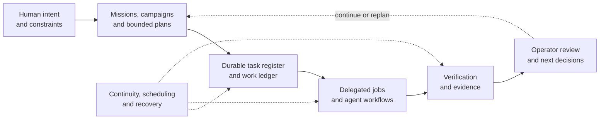

<div align="center">

# CAUSYL

### Keep the mission alive beyond the conversation.

**A persistent, operator-guided laboratory control plane for complex work.**

*From human intent to coordinated tasks, honest recovery, and evidence you can inspect.*

[**The idea ↓**](#more-than-an-agent-chat) · [**See the interface ↓**](#inside-the-operator-plane) · [**Try the verified preview ↓**](#try-the-verified-offline-slice) · [**Current capabilities ↓**](#what-is-ready-today)

<br>


</div>

---

## More than an agent chat

Complex work rarely finishes in one session. Research campaigns span days. Software changes pass through multiple reviews. Experiments depend on earlier results. Machines restart, agents lose context, and a polished status message does not prove that the work was done.

**Causyl is an attempt to give that work a durable home.**

Its intended role is a persistent laboratory assistant and control plane: **the human sets direction; the system tracks the mission, organizes bounded work, delegates to available execution systems, preserves evidence, and makes unfinished or interrupted work visible again.**

The ambition goes beyond coding. The architecture is designed to accommodate **scientific research, engineering and fabrication, materials and structure research, and software development**, without pretending one generic agent can safely perform all those disciplines today.

> **The principle:** An assistant should remember what matters, know what is actually true, and never confuse activity with progress.

## How the laboratory is meant to work



*This is the **intended system model**, not a claim that every arrow is exercised end to end by the 0.1.0a3 public preview.*

<table>
<tr><td width="50%" valign="top">

### 🧭 Missions, not isolated prompts

Turn broad intent into persistent plans, smaller governed tasks, and explicit acceptance conditions. Preserve uncertainty instead of turning it into an improvised command.

</td><td width="50%" valign="top">

### 🤝 Delegation under supervision

Use agent roles, jobs, workflows, and review checkpoints as bounded helpers. The operator remains responsible for direction and authority.

</td></tr><tr><td valign="top">

### 🔄 Continuity through interruption

Keep durable task state, handoffs, and recovery decisions so a restart does not become a fictional success or an automatic rerun.

</td><td valign="top">

### 🔎 Proof before promotion

Associate execution with artifacts, results, and verifiers. If required evidence is missing, work should remain visibly blocked or uncertain.

</td></tr>
</table>

These capabilities have different maturity levels. The full operator service, provider-backed delegation and research workflows are **not certified as an integrated, production-ready laboratory**.

## Inside the operator plane

These are **real interface renders** from the released source, displayed with fictional API data. They are not recordings of real delegated work.

<table>
<tr>
<td align="center" width="50%"><a href="docs/screenshots/change-ledger.png"></a></td>
<td align="center" width="50%"><a href="docs/screenshots/agent-surface.png"></a></td>
</tr>
<tr>
<td align="center"><strong>01 · Track the work</strong><br><sub>Ledger, ownership, states and inspectable history.</sub></td>
<td align="center"><strong>02 · Explore delegation</strong><br><sub>Agent-facing controls, with no real agent called during capture.</sub></td>
</tr>
</table>

<div align="center">
<a href="docs/screenshots/operator-mobile.png"></a>
<br><strong>03 · Stay oriented</strong><br><sub>Operator overview on a smaller screen.</sub>
</div>

<sub>The captures use intercepted synthetic responses, with real network activity, writes and providers blocked. [Screenshot provenance](docs/screenshots/CAPTURE_PROVENANCE.json).</sub>

## What is ready today?

**Causyl 0.1.0a3 is an experimental Linux developer source preview.** Its strongest release claim is a small but real **offline ledger and artifact-integrity workflow**. Some additional action-routing and local HTTP security boundaries have targeted test coverage, but they do not constitute a fully verified autonomous product.

| Area | Public-preview evidence |
|:--|:--|
| Durable ledger and artifact checking | **Verified offline demonstration**, including reopening state and detecting altered bytes |
| Source governance and action policies | 37 reconstructed tracked contracts; rejection and routing tests; not recovered original policy bytes |
| Local operator HTTP boundary | Auth/origin and refusal-path regression tests; opt-in loopback-only service, not a production deployment |
| Scheduler, queues, orchestration, agent interfaces | Components and contracts present; **not validated together for live operations** |
| Provider-backed or autonomous execution | **Not verified in this release** |
| Android client and deployment | Source retained, **not built or validated here** |

The release preparation recorded **383 passing selected tests** on each of Python 3.11, 3.12 and 3.14. The full historic suite, real agents and hosted operations were outside the verified boundary.

## Try the verified offline slice

No provider account, model key, GPU or running operator service is required.

```bash
git clone https://github.com/jedufa/causyl.git
cd causyl
python3 -m tools.release.demo
```

The demo exercises actual Causyl code: it writes a fictional ledger item, opens it with a fresh reader, independently verifies an artifact digest, and confirms that a tampered artifact is rejected. No external calls or agents execute.

For the selected regression suite:

```bash
python3 -m venv .venv
. .venv/bin/activate
python -m pip install -r requirements-test.txt
python -m tools.release.verify
```

The offline demo runs from the source checkout. This preview does not promise an installable wheel or turnkey operator deployment.

## Explore the architecture

Causyl separates **the human-facing plane** from **the durable truth that the plane must display**. The codebase contains experimental work in these areas:

| Surface | Where to look |
|:--|:--|
| Work ledger and histories | `infra/webui/ledger/` |
| Artifacts and experiment records | `experiments/shared/experiment_records/` |
| Scheduling, recovery, resource governance | `infra/controlplane/` |
| Staged pipelines and verification | `infra/pipeline/` |
| Agent integrations | `infra/agents/` |
| Browser and operator HTTP surface | `infra/webui/` |
| Formal action boundaries | [Governance contracts](governance/contracts/README.md) |

The project's [mission contract](governance/plane_mission_contract_v1.json) is the clearest source for its long-term identity. The [limitations](docs/release/LIMITATIONS.md) are the clearest source for what this exact public preview does **not** establish.

## Human direction. Durable truth. Bounded autonomy.

Causyl is **not** intended to be a magical always-thinking agent or an unattended laboratory director. Its design uses durable records and explicit boundaries so the operator can understand what is active, blocked, done, or uncertain.

The current operator runtime is opt-in and single-user on loopback. Agent/provider paths require separate configuration and validation. Do not expose the service on the Internet or assume its source-preview tests certify operational security.

[Local runtime and safeguards →](docs/release/LOCAL_RUNTIME.md) · [Security →](SECURITY.md) · [Limitations →](docs/release/LIMITATIONS.md) · [Dependencies →](docs/release/DEPENDENCIES.md)

## Explore, question, and carry it forward

Causyl is released as experimental, source-only software for study and independent extension. Its vision is deliberately broader than the currently validated demo. Independent forks and focused contributions are welcome, without a promise of maintenance, review, security support or future releases.

[Contributing →](CONTRIBUTING.md) · [License →](LICENSE) · [Third-party notices →](THIRD_PARTY_NOTICES.md)

First-party source, tests and documentation are **MIT licensed**. Copyright © 2026 Jean-Francois Dufour. Third-party materials retain their own terms.

---

<div align="center">

### Give ambitious work a memory. Give progress a proof.

**CAUSYL · A persistent laboratory assistant, with the human in control.**

</div>
